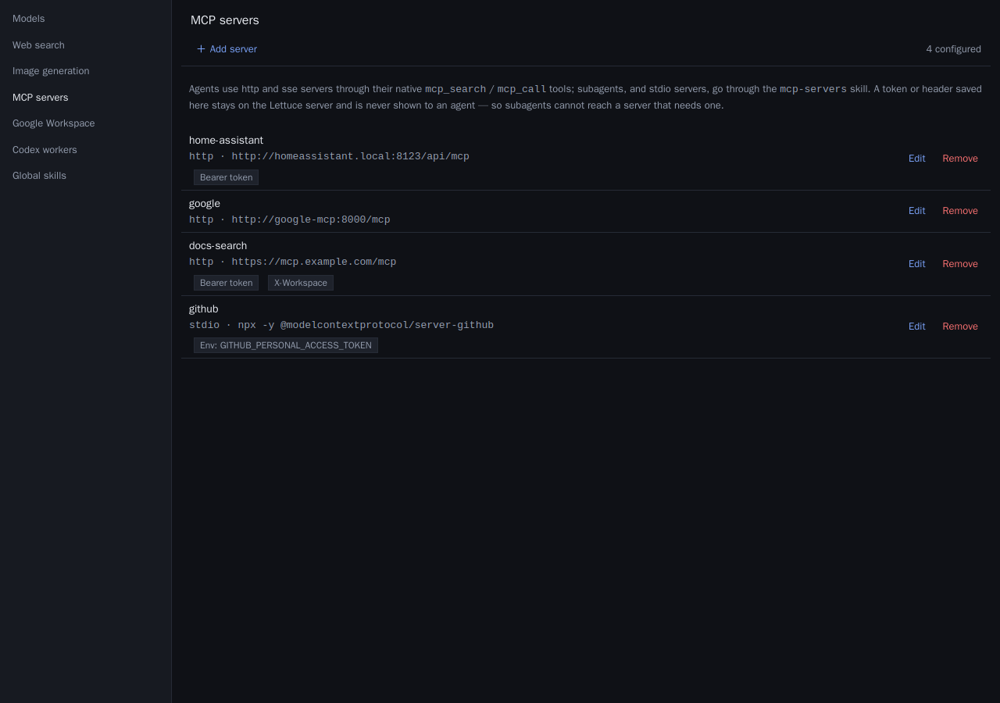
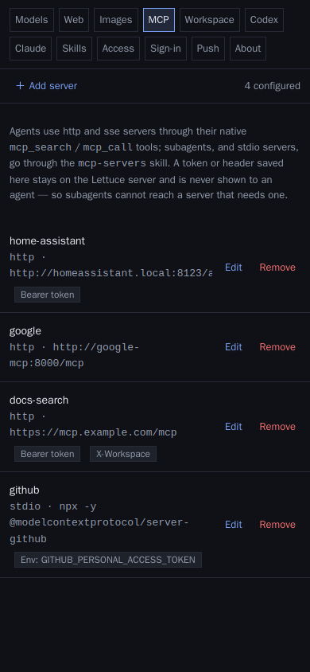
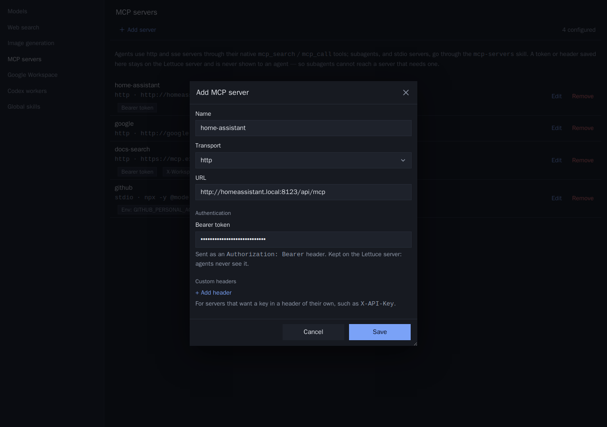
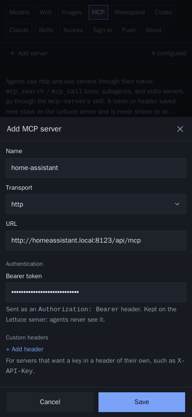
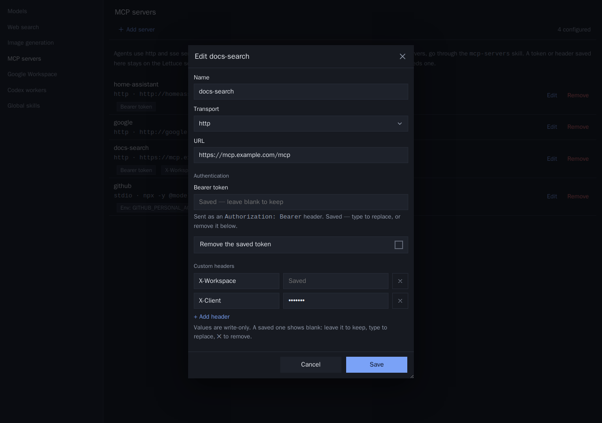
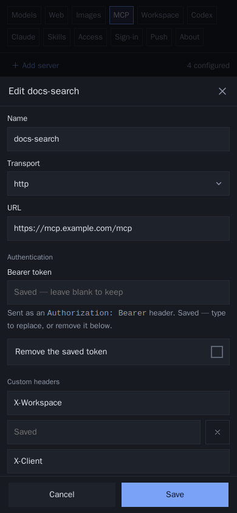
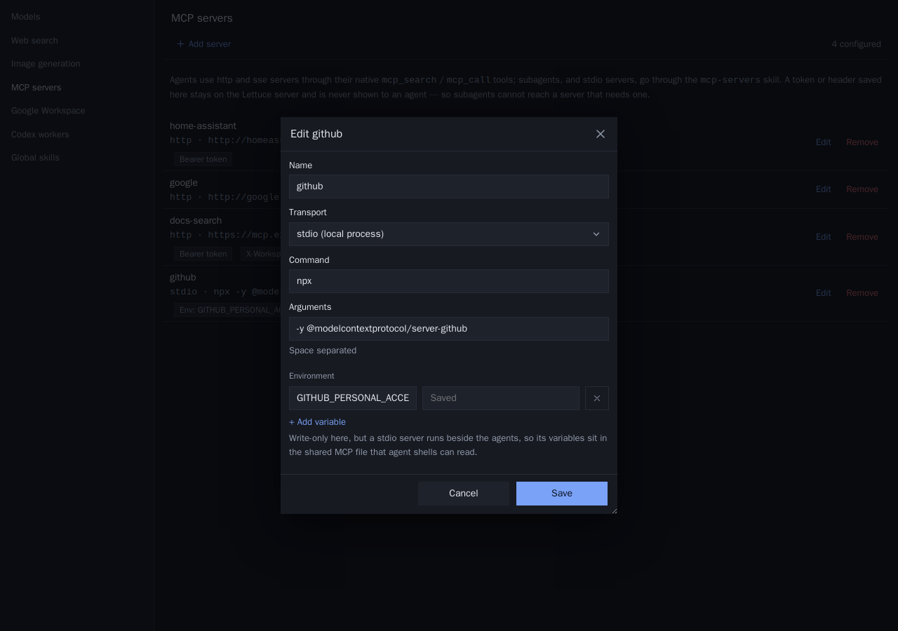
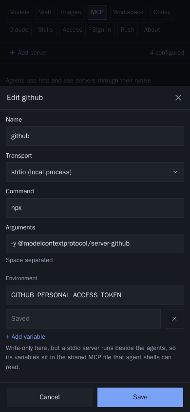

# mcp-auth: tokens and headers for MCP servers

**Flow:** `mcp-auth`, UI change (`--ui`) · **Bump class:** MINOR (new user-facing capability) ·
**Stage:** implement. **Approved** by the operator on 2026-11-21 (plan and mockups as below)

## Problem and root cause

Settings → MCP servers cannot authenticate to a server, so a Home Assistant MCP server (a long-lived
access token sent as `Authorization: Bearer …`) or any API-key server cannot be added from the UI.

The plumbing already carries headers. What's missing is the form, and the browser API leaks headers:

- `validateServer` accepts `headers` and `env` (`bff/src/mcp/settings.ts:93-106`). The bridge sends
  `headers` on connect (`bff/src/mcp-bridge/client.ts:44-50`). Upstream `letta mcp` sends them too,
  expands `${VAR}` from its own environment (`resolveHeaderEnvironment`) and shows them as
  `[REDACTED]` in `list` (`serverDetails` → `redactValues`). Checked in the 0.34.38 bundle; the
  design below does not depend on either behaviour.
- `McpEditor.commit()` (`web/src/components/McpEditor.tsx:92-113`) builds each entry from name,
  transport and command/args or URL only. **Editing a server silently deletes its `headers` and
  `env`**, so anything added by hand to the file is lost on the next edit.
- `GET /api/mcp` (`bff/src/index.ts:1341`) returns the file as written, so any stored header or env
  value reaches the browser in clear.

## Decisions (operator, 2026-11-21)

1. **Header secrets are kept by the BFF only**, on `bff-data`, and added when it connects. Agents never
   see the token. The cost: subagents and the `letta mcp` wrapper cannot reach a server that needs one.
   Precedent: the image-generation API key (`bff/src/images/settings.ts:11-16`).
2. **Values are entered per header and are write-only**, with a **Bearer token** shortcut. No named
   secrets and no `${secret:X}` references.
3. **stdio env gets masked, write-only rows too**, and saving stops wiping it. The values stay in the
   shared MCP file, because a stdio process runs in the app-server; the UI says agents can read them.

## Design

### Where each secret lives

| Secret | Stored in | Who can read it | Who sends it |
|---|---|---|---|
| http/sse bearer token and custom headers | `bff-data:/app/data/mcp-credentials.json` (new) | BFF only | BFF bridge (`mcp_*` tools, Google tools) |
| stdio env | `mcp-home/.letta/settings.json` (as today) | BFF and agent shells | `letta mcp` via the skill wrapper |
| neither, after save | the browser | — | — |

The shared file stays the **only list of servers**. The credentials store holds secrets only, keyed by
server name, and is laid over the list.

### Credentials store (`bff/src/mcp/credentials.ts`, new)

```json
{ "servers": { "home-assistant": {
    "origin": "http://homeassistant.local:8123",
    "bearer": "<token>",
    "headers": { "X-Workspace": "<value>" } } } }
```

- The file is `MCP_CREDENTIALS_FILE`, default `/app/data/mcp-credentials.json` (`config.ts`, next to
  `imagesSettingsFile`). It's written the way `ImagesSettingsStore` writes, and never logged.
- **A saved secret is tied to the origin it was entered for.** Kept values are refused when the server's
  URL now points at a different scheme, host or port (see the PUT rules). At connect, credentials whose
  `origin` doesn't match the server URL are not attached, and that gets logged. This covers a
  hand-edited shared file too. A token entered for Home Assistant is never sent to another host.
- Entries for names no longer in the list are pruned on every successful save.

### Wire format (`/api/mcp`)

**GET** never returns a secret value. It returns names and flags only, like the provider form's
`headerNames`:

```json
{ "servers": [
  { "name": "home-assistant", "transport": "http", "url": "http://homeassistant.local:8123/api/mcp",
    "bearer": true, "headerNames": [] },
  { "name": "github", "transport": "stdio", "command": "npx",
    "args": ["-y", "@modelcontextprotocol/server-github"], "envNames": ["GITHUB_PERSONAL_ACCESS_TOKEN"] }
] }
```

**PUT** sends the whole list, as today. Each entry may add:

| Field | Transports | Meaning |
|---|---|---|
| `was` | any | the name the entry had when loaded, so a rename keeps its saved secrets |
| `bearer` | http, sse | `""` keeps the saved token · a value replaces it · **left out removes it** |
| `headers` | http, sse | per name: `""` keeps the saved value · a value replaces it · **a name left out is removed** |
| `env` | stdio | same rule as `headers` |

One rule for every secret: **a blank keeps what's saved; leaving it out removes it.** Refused with a
400 and a message the editor shows as a toast:

- a blank (keep) with nothing saved under `was ?? name`;
- a kept secret when the URL's origin changed;
- an `Authorization` custom header (any case) alongside `bearer`;
- a header name that isn't an HTTP token;
- `bearer`/`headers` on stdio, or `env` on http/sse.

All work happens inside `service.ts`'s existing `queued` mutation chain, so a Google sync landing
during a save can't interleave. Order: read the current list and credentials, resolve keep/replace/
remove, write the credentials, then write the list and the skill. If the list write fails after the
credentials write, the result is harmless: orphans get pruned next time, and a renamed server keeps its
old name until it's saved again. The response is the GET projection.

### Connect-time merge (the one place secrets are attached)

The `servers` port that feeds `McpCatalog` (`bff/src/index.ts:793`) becomes the list plus credentials
(`withCredentials`): `headers = { ...custom, Authorization: "Bearer <token>" }`. Everything that
connects already gets its server object from the catalog: `mcp_call`/`mcp_call_write`
(`mcp-bridge/tools.ts:181`) and the curated Google tools (`google/tools.ts:590-600`). So
`client.ts`'s `transportFor` stays as it is. `GET /api/mcp` reads the plain list, not this port.

### Migration (every connect, in `ensureMcpServers`)

An http/sse entry that still has `headers` in the shared file (added by hand) has them moved into the
credentials store. An `Authorization: Bearer …` header becomes `bearer`; anything else stays a custom
header. The file is then rewritten without them, and the move is logged by server name and count, never
a value.

A header that holds upstream's `${VAR}` placeholder **stays in the file**, as the approved plan said. It's
a reference that `letta mcp` expands from the app-server's environment, not a secret. The editor lists
it like a saved header, so it can be kept or removed. (The first implementation moved it instead; code
review showed that broke subagents for no gain, so it was put back.)

### Skill and pane text

- `renderMcpSkill` gets the set of servers whose secrets the BFF holds. The description lists them as
  `home-assistant (mcp_* tools only)`, and the body says why: the wrapper would get a 401.
- The editor's intro line adds: "A token or header saved here stays on the Lettuce server and is never
  shown to an agent, so subagents cannot reach a server that needs one."

### Editor (`McpEditor.tsx`)

- **http/sse:** an **Authentication** section with a **Bearer token** password field. When a token is
  saved, the placeholder reads "Saved — leave blank to keep", with a "Remove the saved token"
  `ToggleRow` (the `ImagesSection` pattern). Below it, **Custom headers** uses the provider form's
  `.hdr-row` markup with masked values: a saved row shows its name and a blank value with the
  placeholder "Saved", plus "+ Add header".
- **stdio:** an **Environment** section with the same rows, "+ Add variable", and a note that agent
  shells can read these values.
- **List:** each row shows small tags: `Bearer token`, each custom header name, and `env: NAME`.
- **URL host changed while editing:** the saved fields' hints switch to "The URL now points at a
  different host — re-enter the token, or remove it", and Save stays disabled until the field is
  re-entered or removed. That state isn't mocked; say if you want it mocked.
- **Switching transport** drops the other transport's secrets from the draft.
- New CSS: `.hdr-row.stack` below 600px puts a long name (an env var) on its own line. The provider
  form doesn't use it, so it's unchanged.
- The draft-to-wire logic goes in `web/src/lib/mcp.ts` so it can be tested, like `lib/images.ts`.

## Mockups

Rendered with `bun scripts/mockup.ts` at 1280×900 and 390×844 from `mockups/gen.mjs`, linking the main
checkout's `web/src/styles.css`. This Mac has no bun and no Chromium, so they were rendered inside
`mcr.microsoft.com/playwright:v1.49.1-noble` (bun 1.1.42 installed with npm, `PLAYWRIGHT_CHROMIUM` set
to its `headless_shell`). The desktop rail in the mocks is a stand-in; the sheet and the pane are real
markup.

**Recommendation:** approve these as they are. The one judgement call is the bearer field sitting
apart from custom headers: HA users paste a bare token, and a header row would make them type
`Bearer ` themselves.

### 1. Server list: tags show what's saved

| Desktop 1280 | Phone 390 |
|---|---|
|  |  |

### 2. Add Home Assistant: bearer token being typed

| Desktop 1280 | Phone 390 |
|---|---|
|  |  |

### 3. Edit an http server with saved token and headers: keep, replace, remove

| Desktop 1280 | Phone 390 |
|---|---|
|  |  |

### 4. Edit a stdio server: masked env, saving no longer wipes it

| Desktop 1280 | Phone 390 |
|---|---|
|  |  |

## Files

| File | Change |
|---|---|
| `bff/src/mcp/credentials.ts` (new) | store, origin rule, keep/replace/remove resolution, `withCredentials`, public projection |
| `bff/src/mcp/settings.ts` | validate `was`, `bearer`, header names, the transport/field pairing; projection types |
| `bff/src/mcp/service.ts` | save with credentials inside `queued`; migration in `ensureMcpServers`; prune |
| `bff/src/mcp/skill.ts` | mark servers whose secrets the BFF holds as `mcp_*`-only |
| `bff/src/index.ts` | GET/PUT use the projection and the merge; `servers` port uses `withCredentials` |
| `bff/src/config.ts` | `mcpCredentialsFile` |
| `web/src/components/McpEditor.tsx` | Authentication, Custom headers and Environment sections; list tags; origin rule |
| `web/src/lib/mcp.ts` (new) | draft → wire, origin comparison |
| `web/src/styles.css` | `.hdr-row.stack` at phone width |
| `.agents/skills/lettuce-mcp-and-mods/SKILL.md` | credentials store, merge point, skill marking, env caveat |
| `AGENTS.md` | `bff-data` now also holds MCP credentials (losing them means re-entering tokens); within budget |
| `CHANGELOG.md` | `[Unreleased]` entry |

## Tests

- `credentials.test.ts`: keep, replace and remove for bearer and headers; rename via `was`; origin
  change refuses a kept value but takes a re-entered one; the `Authorization` clash; orphan prune;
  `withCredentials` skips a mismatched origin.
- `settings.test.ts`: the new validation, and the projection never contains a value. The test checks
  the serialized JSON for the secret string.
- `service.test.ts`: header migration (including Bearer → `bearer` and `${VAR}` left in place); env
  keep through an edit; a concurrent Google sync is serialized.
- `skill` test: the mcp_*-only marking.
- `web/src/lib/mcp.test.ts`: draft → wire for each state in the mockups.
- `bun run verify`, then `ui-check` and the visual pass (gate 2) at 390 and 1280.

## Runtime precondition: proven (2026-11-21)

The container test needs **an MCP server that requires a token, reachable from the bff container**.
It is the operator's Home Assistant (MCP Server integration, Streamable HTTP at `/api/mcp`). Its LAN
address stays out of the tree by the operator's instruction; `<ha-host>` below stands for it.

Read-only probe, run with `bun` from a bff container on this host (the image has no `curl`):

```sh
docker exec <bff container> bun -e 'const r = await fetch("http://<ha-host>:8123/api/mcp",
  {method:"POST",headers:{"content-type":"application/json",accept:"application/json, text/event-stream"},
  body:"{}"}); console.log(r.status, r.headers.get("www-authenticate"))'
```

Output:

```
401 Bearer resource_metadata="http://<ha-host>:8123/.well-known/oauth-protected-resource"
```

So the endpoint exists, is reachable from the BFF's namespace, and wants a Bearer token. It also
advertises MCP OAuth (protected-resource metadata), which stays out of scope. A long-lived access
token as `Authorization: Bearer …` is what this flow covers.

## Container test (for Verified?)

1. Add `home-assistant` with a bearer token. An agent's `mcp_search "light"` lists HA tools, and a
   read tool runs.
2. The `/api/mcp` response in devtools has no token. Grepping `/root/.letta` in app-server for a token
   prefix counts **0** matches; the token itself is never printed.
3. Edit the server without touching the token: it still works. Rename it: still works. Change the URL
   host: Save refuses until the token is re-entered or removed.
4. Remove the token: HA calls fail with 401, and the list tag disappears.
5. A stdio server with env: edit its arguments without retyping the value, and the env survives.
6. The `mcp-servers` skill description marks `home-assistant` as `mcp_*`-only.

## Not in scope

OAuth for MCP (upstream supports it; separate flow). Sending the wrapper's http calls through the BFF
(would give subagents authenticated servers). The provider form's coarser all-or-nothing header
semantics.

## Process note

This plan was drafted from a Claude Code session in `.worktrees/mcp-auth` (branch `mcp-auth`, at
`8569f8a`). That's not the worktree dev-flow creates. Run `flow start mcp-auth --ui` in pi so the gates
own this directory; `flow approve` then cuts `feat/mcp-auth` at `.dev-flow/mcp-auth/worktree`, and
`.worktrees/mcp-auth` can be retired.
